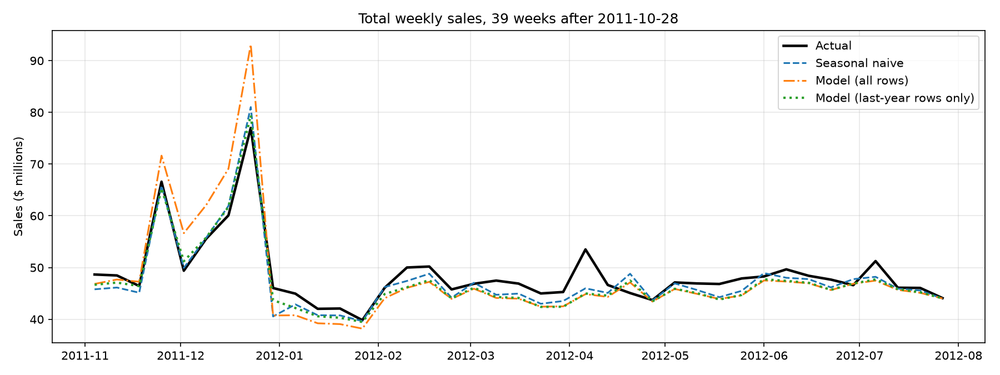
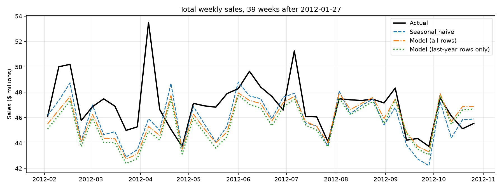

# Walmart Store Sales Forecasting

Weekly sales forecasting for 3,331 Walmart store-department series, built on the Kaggle *Walmart Recruiting - Store Sales Forecasting* data. The project compares simple seasonal baselines with a gradient-boosting model that learns corrections to them, and evaluates everything with a chronological, 39-week, holiday-weighted metric.

**Main result:** seasonal naive (same week last year) is a very strong baseline on this data. A model that corrects it can beat it by about **3-8% WMAE**, but only when it is trained carefully. A first version lost to the baseline in the holiday season because it counted the Christmas peak twice. The cause was diagnosed and fixed, and the result was checked on a second time window.

## Contents

- [Dataset](#dataset)
- [Approach](#approach)
- [Results](#results)
- [Key findings](#key-findings)
- [Limitations](#limitations)
- [Reproducing the results](#reproducing-the-results)
- [Repository structure](#repository-structure)
- [Future improvements](#future-improvements)

## Dataset

**Source:** [Walmart Recruiting - Store Sales Forecasting (Kaggle)](https://www.kaggle.com/competitions/walmart-recruiting-store-sales-forecasting/data). The raw files are not stored in this repository; download them from Kaggle into `data/raw/`.

| File | Description |
|---|---|
| train.csv | Historical weekly sales (Feb 2010 - Oct 2012) |
| features.csv | Temperature, fuel price, CPI, unemployment, markdowns (not used in the current models) |
| stores.csv | Store type and size |
| test.csv | Weeks to be forecast in the original competition |
| sampleSubmission.csv | Example submission format |

| File | Rows | Columns |
|---|---:|---:|
| train | 421,570 | 5 |
| features | 8,190 | 12 |
| stores | 45 | 3 |
| test | 115,064 | 4 |

The training data holds 3,331 store-department weekly series. Exploratory analysis is in `notebooks/01_data_understanding.ipynb` and `notebooks/02_exploratory_data_analysis.ipynb`. Findings that shaped the modelling:

- Sales have a strong yearly pattern with Thanksgiving and Christmas peaks.
- The `IsHoliday` flag does not mark the weeks just before Christmas, which are among the biggest of the year.
- Many series are short or have gaps, so every forecast needs a fallback.
- Negative weekly sales exist and are kept.

## Approach

The whole pipeline, with explanations, is in `notebooks/03_forecasting_from_scratch.ipynb`.

### Validation design

Models are evaluated with chronological holdouts, never random splits. Two windows are used, each forecasting **39 weeks** (the length of the competition's test period):

| Window | Training data up to | Evaluation period | Notes |
|---|---|---|---|
| 1 | 2011-10-28 | 2011-11-04 to 2012-07-27 | Includes Christmas. Training holds only one Christmas (2010). |
| 2 | 2012-01-27 | 2012-02-03 to 2012-10-26 | No Christmas. Training holds Christmas 2010 and 2011. |

The windows overlap from February to July 2012 and share training data, so they are not independent tests.

### Metric

Weighted mean absolute error (WMAE) from the competition: holiday weeks count five times.

$$WMAE = \frac{\sum_i w_i\,|y_i-\hat{y}_i|}{\sum_i w_i},\qquad w_i = 5 \text{ for holiday weeks, } 1 \text{ otherwise}$$

### Baselines

1. **Last observed:** repeat each series' most recent training value.
2. **Seasonal naive:** use the value from the same week 52 weeks earlier. If it is missing, fall back to the last observed value, then the department median, then the overall median (all computed from training data only).

### Model

**Direct forecasting from a forecast origin.** The origin is the last week with known sales. For each target week `origin + h` (h = 1 to 39) the features use only information available at the origin. Because the horizon is under 52 weeks, last year's sales (weeks 51, 52 and 53 back) always lie before the origin, so predictions are never fed back in as inputs.

Features: last year's sales and their average, recent level (mean of the last 4 and 13 weeks, last value), weeks ahead, week of year, month, `IsHoliday`, days to Christmas, store type and size, store and department.

**Training:** many past forecast origins (every 4 weeks), each forecasting up to 39 weeks ahead. Targets never go past the cutoff.

**Learning target:** the residual `actual - seasonal naive`, so the model starts from the baseline and learns corrections. `HistGradientBoostingRegressor` with absolute-error loss, holiday rows weighted 5x, and categorical store/department/type. Early stopping is off, because its random hold-out would break time order.

Two versions are compared:

- **All rows:** trained on every training row.
- **Last-year rows only:** trained only on rows that have a last-year value, so the base always has the same meaning. Rows without one use plain seasonal naive.

### Checks built into the notebook

- A test of WMAE against a hand-computed value.
- A leakage check: overwriting every value after the origin with garbage changes no feature.
- An assertion that training targets never pass the cutoff.
- A check that the feature code reproduces the baseline forecasts exactly.

## Results

WMAE and MAE in dollars per store-department-week; lower is better. Percentages are relative to seasonal naive on the same window.

### Window 1: train to 2011-10-28 (evaluation includes Christmas)

| Model | WMAE | MAE | WMAE vs seasonal naive |
|---|---:|---:|---:|
| Seasonal naive | 2,043.61 | 1,963.47 | baseline |
| HistGradientBoosting (all rows) | 2,175.57 | 2,054.92 | 6.5% worse |
| HistGradientBoosting (last-year rows only) | 1,876.75 | 1,823.97 | 8.2% better |
| Last observed | 3,871.37 | 3,523.28 | 89% worse |

### Window 2: train to 2012-01-27 (no Christmas in evaluation)

| Model | WMAE | MAE | WMAE vs seasonal naive |
|---|---:|---:|---:|
| Seasonal naive | 1,803.03 | 1,801.47 | baseline |
| HistGradientBoosting (all rows) | 1,701.06 | 1,697.36 | 5.7% better |
| HistGradientBoosting (last-year rows only) | 1,741.41 | 1,736.32 | 3.4% better |
| Last observed | 3,198.66 | 3,125.86 | 77% worse |

The ML scores can change slightly between runs of the same code. An earlier run gave 2,134.97 for the all-rows model in window 1 (against 2,175.57 above), a 41-point difference, while the other three ML scores moved by less than 4 points. The all-rows model in window 1 is the case whose training data has no Christmas example with a last-year value, which may be why its behaviour is less stable. Small differences between ML models should not be over-read.

### Error by forecast horizon (MAE, all-rows model)

| Horizon | Window 1: seasonal naive | Window 1: model | Window 2: seasonal naive | Window 2: model |
|---|---:|---:|---:|---:|
| Weeks 1-13 | 2,072 | 2,562 | 1,984 | 1,845 |
| Weeks 14-26 | 2,009 | 1,926 | 1,736 | 1,600 |
| Weeks 27-39 | 1,808 | 1,672 | 1,683 | 1,646 |

### Error by holiday flag (MAE, all-rows model)

| Weeks | Window 1: seasonal naive | Window 1: model | Window 2: seasonal naive | Window 2: model |
|---|---:|---:|---:|---:|
| Holiday | 2,301 | 2,563 | 1,811 | 1,719 |
| Non-holiday | 1,935 | 2,012 | 1,801 | 1,696 |

### Why the all-rows model lost in window 1

Window 1, weeks with last-year values, average per row:

| Days relative to Christmas | Actual change vs last year | Added by all-rows model |
|---|---:|---:|
| Dec 26-31 | +1,936 | +78 |
| 0-14 before Christmas | -1,001 | +3,305 |
| 15-28 | -116 | +2,244 |
| 29-59 | +623 | +907 |
| 60 or more | +470 | -305 |

In the two weeks before Christmas, sales were slightly *below* last year, yet the model added about $3,300 per row. The only Christmas in training (2010) has no last-year value, so the Christmas jump ends up in the learned correction. At test time the base is last year's value, which already contains the peak, and the model adds the jump again. Training only on rows that have a last-year value avoids this: its WMAE in window 1 improves to 1,876.75, 8.2% better than seasonal naive.



*Total weekly sales over the 39 weeks after 2011-10-28 (all stores and departments). The all-rows model (orange) overshoots the December peak, reaching about $93M against about $77M actual. The last-year-rows-only model (green dotted) stays close to actual and to seasonal naive.*



*Total weekly sales over the 39 weeks after 2012-01-27. All three forecasts follow the weekly shape and mostly sit below actual from February to June. The two models are nearer actual than seasonal naive in several weeks (for example late September). All three miss the Super Bowl, Easter (Apr 8) and July 4 weeks, and all three show a bump around Apr 20 (last year's Easter week) instead of Apr 6.*

## Key findings

- **Seasonal naive is hard to beat.** Corrections from a boosted model improve WMAE by roughly 3-8%, not dramatically.
- **A model can look good and be wrong in the season that matters most.** The all-rows model is 5.7% better than the baseline in window 2 but 6.5% worse in window 1, driven by how it handled Christmas.
- **The cause was identified with evidence, not guessed.** The diagnostic table shows the double counting. The remedy (training only where last-year values exist) beats the baseline in both windows.
- **The restricted model is the safer default.** It never lost to seasonal naive. The all-rows model is slightly better when holiday history is available.
- **Time-aware validation changes conclusions.** The first version of this project used a short 12-week window with almost no major holidays and a recursive forecast loop that fed predictions back in; the 39-week windows and direct forecasting give a more honest picture.

## Limitations

- Two overlapping windows, and the restricted model was designed after seeing window 1, so its advantage is suggestive rather than proven.
- No window tests Christmas when training holds two Christmases. The data ends in October 2012.
- Run-to-run variation in the ML scores, up to about 2% for the all-rows model in window 1.
- `features.csv` (weather, fuel price, CPI, unemployment, markdowns) is not used. Markdowns only exist from November 2011, so they are unavailable in window 1 training.
- Easter, July 4 and Super Bowl effects are not modelled; the plots show both models missing those weeks.
- One global model for all series, with no per-department tuning and no systematic hyperparameter search.

## Reproducing the results

1. Install the requirements: `python -m pip install -r requirements.txt`
2. Download `train.csv`, `features.csv`, `stores.csv` and `test.csv` from Kaggle into `data/raw/` (the two EDA notebooks read all four; the forecasting notebook only needs `train.csv` and `stores.csv`).
3. Open `notebooks/03_forecasting_from_scratch.ipynb` (Jupyter or VS Code).
4. Run all cells from top to bottom. The first cell sets `CUTOFF = "2011-10-28"` (window 1).
5. Change `CUTOFF` to `"2012-01-27"` and run all cells again (window 2).

Each run writes `reports/results_<cutoff>.csv` and `reports/forecast_vs_actual_<cutoff>.png`, so both windows are kept.

## Repository structure

```
notebooks/
  01_data_understanding.ipynb         data checks
  02_exploratory_data_analysis.ipynb  EDA
  03_forecasting_from_scratch.ipynb   full pipeline, diagnostic and plots
reports/                              result tables and figures (written by the notebook)
data/raw/                             Kaggle files (not committed)
requirements.txt
.gitignore
```

## Future improvements

- Add Easter, July 4 and Super Bowl features (the plots show clear misses on those weeks).
- Add a recent year-over-year growth feature, since actual sales run above last year's level.
- Use `features.csv` (weather, CPI, unemployment, markdowns).
- Compare with per-series ETS or STL models.
- Evaluate on more cutoffs and repeat the ML fits to report a range.
- Tune hyperparameters systematically, and try per-department models.

## Author

**Mark Reji**

M.Sc. Statistics Student | Data Science & Analytics

- GitHub: [markreji2027](https://github.com/markreji2027)
- LinkedIn: [Mark Reji](https://linkedin.com/in/mark-reji-29488b246)

---

*An independent data science and forecasting project using the Kaggle Walmart Recruiting Store Sales Forecasting dataset.*
